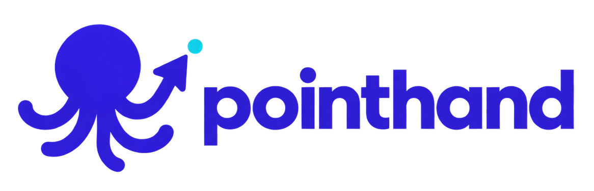
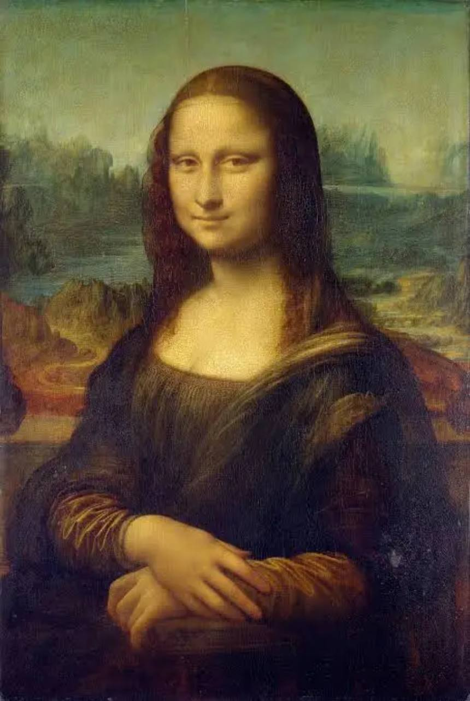
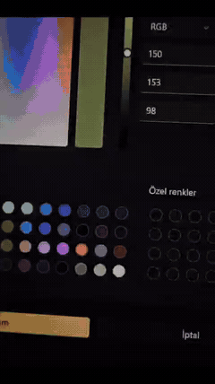

<p align="center">
  
</p>

<h3 align="center">Give your AI a hand on Windows.</h3>

<p align="center">
  See the screen. Work with desktop apps. Draw through real mouse input.<br>
  A Windows computer-use MCP server for creative and practical workflows.
</p>

<p align="center">
  <a href="https://github.com/ayzekhdawy/pointhand/actions/workflows/windows.yml"></a>
  <a href="https://github.com/ayzekhdawy/pointhand/releases"></a>
  <a href="LICENSE"></a>
  
</p>

<p align="center">
  <a href="https://github.com/ayzekhdawy/pointhand/releases"><b>Download</b></a> ·
  <a href="#quick-start"><b>Quick start</b></a> ·
  <a href="examples/mona-lisa/README.md"><b>Mona Lisa demo</b></a> ·
  <a href="docs/technical-reference.md"><b>API reference</b></a> ·
  <a href="CONTRIBUTING.md"><b>Contribute</b></a> ·
  <a href="https://github.com/ayzekhdawy/pointhand/issues"><b>Feedback</b></a>
</p>

---

## From a reference to a canvas

PointHand reproduced the Mona Lisa in Microsoft Paint through its own MCP server. The reusable script selects colors and draws mouse strokes into the canvas.

<table>
  <tr>
    <th align="center">The reference</th>
    <th align="center">Drawn in Paint</th>
    <th align="center">Watch it take shape</th>
  </tr>
  <tr>
    <td align="center" width="33%"></td>
    <td align="center" width="33%"></td>
    <td align="center" width="33%"><a href="examples/mona-lisa/demo.mp4"></a></td>
  </tr>
</table>

<p align="center">
  <a href="examples/mona-lisa/demo.mp4"><b>Watch the recorded drawing ↗</b></a> &nbsp; · &nbsp;
  <a href="examples/mona-lisa/README.md">Run it yourself</a> &nbsp; · &nbsp;
  <a href="examples/mona-lisa/strokes.json">Explore the stroke plan</a>
</p>

## Built for desktop work

| Observe | Interact | Create |
| :--- | :--- | :--- |
| Find apps and windows, capture screenshots, inspect the UI Automation tree, and record speaker loopback. | Move, click, drag, scroll, type, use key chords and work with the clipboard. | Draw freehand paths and geometric shapes with a native cursor and visible activity frame. |

The TypeScript MCP server connects your agent to a native Rust host. Windows input, accessibility and the overlay run in that host. The portable package needs **Node.js 20+**; Rust and Python are only needed for development or optional components.

**Release status:** **v0.2.0-alpha.5** is an alpha for supervised workflows with 28 MCP tools (the next release adds background mode, element search, waits, window management and update notices for 35). Accessibility lines name only the actions an element can run, and `start_audio_recording` records what Windows is playing. See the [release notes](docs/releases/alpha-5.md) and [validation limits](docs/release-checklist.md). Alpha 4 remains available.

## Quick start

1. Download the Windows x64 ZIP and its SHA-256 file from [Releases](https://github.com/ayzekhdawy/pointhand/releases).
2. Verify the ZIP with `Get-FileHash -Algorithm SHA256`, then extract it.
3. Install Node.js 20 or newer and add PointHand to your MCP client:

```json
{
  "mcpServers": {
    "pointhand": {
      "command": "node",
      "args": ["C:/Tools/PointHand/client/dist/index.js"],
      "env": {
        "POINTHAND_ALLOW": "mspaint.exe,Illustrator.exe"
      }
    }
  }
}
```

Replace the path with the extracted package's `client/dist/index.js`. Set the allow-list to the apps you want the agent to control; leaving it empty allows every app.

Open a blank Paint canvas and try:

> Use PointHand to inspect the Paint window, select a drawing tool and draw a small fish in the center of the canvas.

For the complete portrait workflow, follow the [Mona Lisa tutorial](examples/mona-lisa/README.md), including the reference, ready-made plan and script instructions.

## Use with Grok App / Grok CLI

PointHand is a plain stdio MCP server, so any MCP client can load it. [Grok App](https://github.com/RongleCat/grok-app) (and its GrokCLI fork) recognise it as a one-click preset:

1. Download and extract this release ZIP, install Node.js 20+.
2. In the app open **Settings → Extensions → MCP → Add server → Fill in PointHand**. Replace the sample path with your extracted `client/dist/index.js`, then press **Add**.
3. Optional: **Install PointHand skill** writes [`skills/pointhand/SKILL.md`](skills/pointhand/SKILL.md) into the user skills folder so the agent knows the look → act → verify workflow. Terminal users can copy that file to `~/.grok/skills/pointhand/SKILL.md` and add the same config by hand:

```toml
[mcp_servers.pointhand]
command = "node"
args = ["C:/Tools/PointHand/client/dist/index.js"]

[mcp_servers.pointhand.env]
POINTHAND_ALLOW = "mspaint.exe"
```

Physical Escape still stops PointHand at any time. Full walkthrough: the Grok App docs once the companion PR lands, or the Quick start section above.

## Visible control. A clear way to stop.

- **Native feedback:** a click-through glass frame, activity label, cursor trail and click ripple show PointHand's activity. The overlay targets 60 FPS and is excluded from screenshots by default.
- **Stop:** once an action has started, mouse movement and clicks do not cancel it. Physical Escape stops further mutations until the server restarts.
- **Scoped access:** restrict receiving apps with executable names or exact paths in `POINTHAND_ALLOW`.
- **Input cleanup:** interrupted strokes release held buttons. Alpha 2 also provides an out-of-band `emergency_stop` tool that stops active and queued mutations until restart.

Use PointHand in a supervised desktop session. App permissions are a guardrail, not a sandbox against malicious local software. Window screenshots use the window's own pixels when Windows graphics capture is available, so a covered window stays where it is. Pointer actions bring that window forward and do not click a window that remains on top. That refusal names the covering process and returns a fresh screenshot of the target so the action can be retried once. Desktop screenshots are the visible composite. Elevated windows can still reject input. Read the [security policy](SECURITY.md) and [input behavior guide](docs/input-behavior.md).

## Tested on the desktop

| Scenario | Alpha 2 validation |
| :--- | :--- |
| Paint drawing | Live strokes, shapes and Turkish color-dialog controls through PointHand MCP |
| Extended desktop | 125% primary + 100% virtual secondary, streamed to a phone with Sunshine |
| Coordinate precision | Exact click and stroke endpoints with the secondary display on either side |
| Stop | Escape and `emergency_stop` cancel a held-button drawing and release the button. Mouse movement does not. |
| Emergency stop | Active drawing cancelled, held button released and queued mutation blocked |
| Portable package | Windows CI checks ZIP extraction, SHA-256, executable manifest and isolated MCP startup |

Streamed mixed-DPI overlay runs averaged approximately **57–59 FPS** at a 60 FPS target. These are observed renderer timings, not a display-refresh guarantee.

Secure-desktop switching, display disconnection during input, more physical monitor combinations and a clean non-developer PC remain to verify. See the [full validation checklist](docs/release-checklist.md) and [multi-monitor report](docs/multimonitor-validation.md).

## Help shape PointHand

Contributions are welcome in **English or Turkish**. You can help with code, documentation, creative examples or compatibility reports.

- **New here?** Pick a [good first issue](https://github.com/ayzekhdawy/pointhand/labels/good%20first%20issue).
- **Have a Windows setup to test?** Share a [compatibility report](https://github.com/ayzekhdawy/pointhand/issues/new?template=compatibility_report.yml).
- **Ready to build?** Read [CONTRIBUTING.md](CONTRIBUTING.md) and browse [help wanted](https://github.com/ayzekhdawy/pointhand/labels/help%20wanted).
- **Have an idea?** Propose a [workflow or creative example](https://github.com/ayzekhdawy/pointhand/issues/new?template=feature_request.yml).

We especially need clean-install reports, English Paint checks and more physical-monitor/DPI coverage. Small, reproducible contributions help make the next release stronger.

## Develop PointHand

The main implementation uses **TypeScript + Rust + Windows APIs**. The optional Python server is a reference implementation.

| Directory | Responsibility |
| :--- | :--- |
| [`client/`](client/) | MCP tools, request lifecycle and image results |
| [`host/`](host/) | Native input, UI Automation, screenshots, clipboard, guards and overlay |
| [`scripts/`](scripts/) | Build, packaging, verification and creative examples |
| [`pointhand/`](pointhand/) | Optional Python reference server |

<details>
<summary><b>Build from source</b></summary>

Requires stable Rust and Visual Studio Build Tools with **Desktop development with C++**, plus Node.js 20+.

```powershell
./scripts/build-windows.ps1
npm ci --prefix client
npm run build --prefix client
```

The build writes the native executable and checksum manifest to `bin/windows/x64/`. Configure your MCP client with the absolute `client/dist/index.js` path in this checkout. `POINTHAND_HOST` can select a custom host executable.

To build and verify a portable package:

```powershell
./scripts/package-windows.ps1
./scripts/verify-package.ps1
```

</details>

<details>
<summary><b>Run automated and interactive checks</b></summary>

```powershell
npm test --prefix client
node --test tests/js/*.test.mjs
cargo test --release --manifest-path host/Cargo.toml
cargo clippy --release --manifest-path host/Cargo.toml -- -D warnings
node --test scripts/host-regression.mjs
```

Optional Python checks require `python -m pip install -e ".[test]"`, followed by `python -m pytest`.

Interactive tests move the real pointer and open a disposable test window. They use PointHand MCP and require Python with Tkinter:

```powershell
node scripts/native-input-e2e.mjs
node scripts/native-multimonitor-e2e.mjs
node scripts/manual-physical-e2e.mjs
```

The multi-monitor test requires an extended second display. The manual test requires you to move a physical mouse or touchpad after drawing starts. Instructions and expected results are in the [validation checklist](docs/release-checklist.md).

</details>

## Documentation

| Guide | What you will find |
| :--- | :--- |
| [Mona Lisa in Paint](examples/mona-lisa/README.md) | Demo, drawing script and reusable stroke plan |
| [Technical reference](docs/technical-reference.md) | Tool names, coordinates, key aliases, protocol and overlay settings |
| [Pointer behavior](docs/input-behavior.md) | Motion, acceleration and drawing precision |
| [Validation checklist](docs/release-checklist.md) | Completed checks and remaining coverage |
| [Multi-monitor validation](docs/multimonitor-validation.md) | Mixed-DPI measurements and hardware limits |
| [Changelog](CHANGELOG.md) | Published release and source-branch changes |

---

<p align="center">
  Built by <a href="https://github.com/ayzekhdawy"><b>@ayzekhdawy</b></a> · <a href="LICENSE">MIT licensed</a><br>
  <sub>Independent implementation using documented Windows APIs.</sub>
</p>
